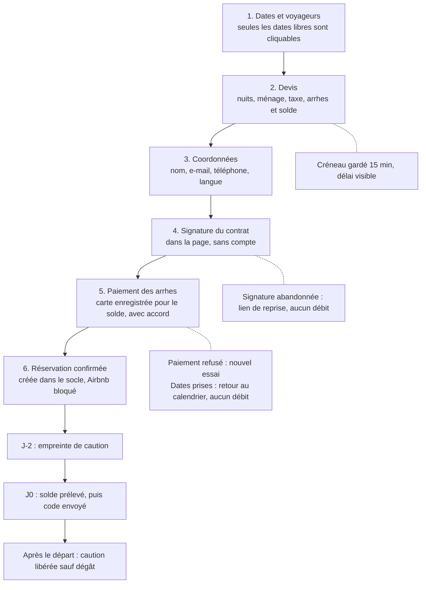
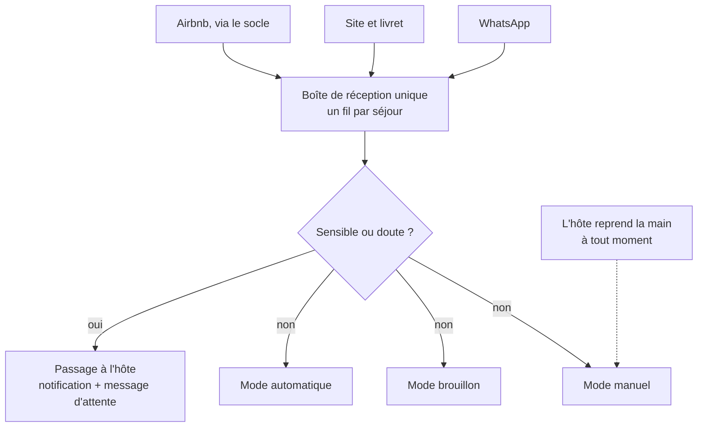

# Spécification UX – Le Habert insolite

Phase 2 BMAD (Planification, UX) · 5 novembre 2026, mis à jour le 6 novembre 2026 · Jérôme

## Principes

Le site doit donner envie comme une annonce Airbnb soignée, rassurer comme elle au moment de payer, puis faire mieux qu'elle pendant le séjour. Base : le PRD et le site vitrine v0 (`reference/site-v0/`).

1. **Le chalet d'abord.** Photos et paysage portent la page ; le texte reste court et concret.
2. **La confiance au moment de payer.** Avis visibles, prix détaillé avant tout engagement, paiement chez un prestataire reconnu, coordonnées réelles des hôtes.
3. **Un seul écran à la fois sur téléphone.** Chaque étape du tunnel tient sur un écran et dit ce qui vient ensuite.
4. **Le voyageur ne choisit jamais une date impossible.** Le calendrier empêche l'erreur au lieu de la signaler.
5. **L'hôte garde la main.** Rien d'important ne part sans qu'il puisse le voir ; l'assistant signale toujours quand il passe le relais.
6. **Quatre langues sans couture.** La langue choisie suit le voyageur dans les e-mails, le contrat, le livret et l'assistant.

## Identité visuelle

Reprise du site v0 : forêt de Chartreuse, calcaire des falaises, vert de la liqueur. La ligne de crête sous la photo d'ouverture est la signature graphique, deux fois au maximum par page.

| Rôle | Nom | Valeur | Usage |
| --- | --- | --- | --- |
| Fond principal | Calcaire | `#F2F3EF` | Fond des pages |
| Couleur de marque | Sapin | `#1E3A2F` | Titres, bandeaux, espace hôte |
| Accent | Chartreuse | `#C5D33F` | Boutons d'action principaux, dates choisies |
| Texte | Ardoise | `#263034` | Texte courant |
| Secondaire | Belledonne | `#587684` | Textes d'appui, légendes |
| Occupé | Lichen | `#BCCBC2` | Dates réservées, états inactifs |

- **Typographie** : Alegreya (titres, chiffres), Alegreya Sans (texte, interface).
- **Ton** : chaleureux et précis, au « vous », phrases courtes ; les messages disent ce qui se passe et ce qu'il faut faire.
- **Nom** : « Le Habert insolite » ; logo à créer.

## Architecture du site

Un seul site, trois espaces :

| Public (sans connexion, indexé) | Voyageur avec séjour (lien privé) | Hôte (double facteur) |
| --- | --- | --- |
| Accueil — V1 | Mon séjour — V2 | Calendrier — V1 |
| Le chalet — V1 | Livret d'accueil — V2 | Contenus et prix — V1 |
| Disponibilités — V1 | Paiements — V2 | Séjours — V2 |
| Réserver — V2 | Contrat et factures — V2 | Comptabilité — V2 |
| Alentours et carte — V3 | Carte complète — V3 | Taxe de séjour — V2 |
| Avis — V1 | Assistant — V4 | Bons plans — V3 |
| Contact — V1 | | Boîte de réception — V4 |
| Mentions légales — V1 | | Réglages assistant — V4 |
| Journal — V1.5 | | Rédaction du journal — V1.5 |

Une réservation ouvre l'espace séjour. Les pages publiques existent en `/fr`, `/en`, `/de`, `/nl`. L'espace séjour s'ouvre sans mot de passe, par un lien privé envoyé par e-mail ou WhatsApp : c'est aussi la porte d'entrée des voyageurs Airbnb vers le livret et la carte.

## Tunnel de réservation

Six écrans sur téléphone, devis toujours visible. La signature précède le paiement : jamais de débit sans contrat signé.

Une barre de progression nomme les six étapes ; retour en arrière possible sans perte de saisie. Le code de la boîte à clés n'est envoyé qu'une fois le solde réglé, sous réserve de confirmation (question ouverte du PRD).

## Écrans voyageur

| Écran | Contenu | Action principale | Comportement clé |
| --- | --- | --- | --- |
| Accueil | Photo d'ouverture et ligne de crête, chiffres clés, note 5,0 sur Airbnb | Voir les disponibilités | Bouton de réservation fixe en bas sur téléphone dès la V2 |
| Le chalet | Galerie, chambres, équipements | Voir les disponibilités | Galerie plein écran, glissement au doigt |
| Disponibilités | Calendrier sur 2 mois (1 sur téléphone), prix par nuit | Choisir arrivée puis départ | Dates impossibles désactivées ; arrivée/départ en diagonale ; total mis à jour à chaque clic |
| Devis | Lignes détaillées, arrhes et solde datés, annulation en clair | Continuer | Repliable mais toujours visible dans le tunnel |
| Signature | Contrat lisible, résumé des points clés au-dessus | Signer | Code de confirmation par SMS ou e-mail ; PDF téléchargeable |
| Paiement | Montant des arrhes, accord pour le prélèvement du solde | Payer les arrhes | Authentification forte gérée par Stripe ; compte à rebours du créneau |
| Mon séjour | Dates, statut des paiements, compte à rebours | Ouvrir le livret | Une carte par étape franchie ; code affiché quand disponible |
| Livret d'accueil | Accès, wifi, règles, chauffage, poubelles, urgences | Rechercher | Consultable hors ligne ; bouton d'appel à l'hôte |
| Carte | Lieux par catégorie, fiche au toucher | Filtrer | Liste et carte synchronisées ; itinéraire vers l'application de navigation |
| Assistant | Fil de conversation, suggestions | Poser une question | Mention « assistant », « Jérôme » ou « Laura » sur chaque message ; bouton pour joindre l'hôte |
| Journal | Articles par thème et date, auteur et date visibles | Lire un article | En fin d'article : lieux cités, prochaines dates libres, articles proches |

## Boîte de réception et reprise en main

- **Liste des fils** : un fil par séjour avec pastille de canal, dates, dernier message, mode en cours. Fils passés à l'hôte en tête, en orange.
- **Dans un fil** : auteur de chaque message (voyageur, assistant, Jérôme, Laura) ; bandeau du séjour (dates, paiements, caution). Bouton « Reprendre la main » toujours visible ; en manuel, il devient « Rendre la main à l'assistant ».
- **Brouillons** : la réponse proposée s'affiche dans la zone de saisie ; envoyer, modifier ou jeter.

## Écrans hôte

| Écran | Contenu | Action principale | Comportement clé |
| --- | --- | --- | --- |
| Tableau de bord | À traiter (fils transmis, paiement en échec, contrat non signé), prochaines arrivées, occupation du mois, part des nuits en direct | Ouvrir l'élément à traiter | Vide = « Rien à traiter » et prochaine arrivée |
| Séjours | Liste par date, canal, statut contrat, arrhes, solde, caution | Ouvrir un séjour | Actions : encaisser, retenir une partie de la caution, annuler, renvoyer le livret |
| Calendrier | Occupation sur 3 mois, prix par nuit, origine des réservations | Bloquer des dates | Blocage répercuté sur Airbnb via le socle, avec confirmation |
| Tarifs | Saisons, règles, durée minimale, majoration Airbnb | Modifier une règle | Aperçu du prix sur 3 mois avant d'enregistrer |
| Contenus | Textes du site, du livret et de l'assistant dans les 4 langues | Modifier un texte | Traduction proposée à relire ; langue manquante signalée |
| Bons plans | Lieux sur la carte, par catégorie | Ajouter un lieu | Position au doigt ou par GPS ; fiche traduite à relire |
| Comptabilité | Recettes, dépenses, justificatifs, solde de l'année | Ajouter une dépense | Photo du justificatif ; export annuel en un clic |
| Taxe de séjour | Nuitées et personnes par période, montant à reverser | Préparer la déclaration | Mode non classé ou classé ; rappel avant échéance |
| Réglages assistant | Mode par canal, sujets toujours transmis, ton, horaires | Changer un mode | Test sur une question avant de publier |
| Rédaction du journal | Idée de la semaine, brouillons, articles programmés, visites par article et langue | Nouvel article | Notes dictées et photos ; brouillon et traductions côte à côte ; Publier seulement après relecture des 4 langues |

## Messages, états vides et erreurs

Un message dit ce qui s'est passé et ce que l'on peut faire, sans s'excuser ni rester vague.

| Situation | Message | Action proposée |
| --- | --- | --- |
| Dates prises pendant le paiement | « Ces dates viennent d'être réservées. Rien n'a été débité. » | Choisir d'autres dates |
| Créneau expiré | « Vos dates ne sont plus gardées. Elles sont encore libres : reprenez où vous en étiez. » | Reprendre la réservation |
| Paiement refusé | « Votre banque a refusé le paiement. Rien n'a été débité. » | Réessayer, autre carte |
| Solde non prélevé | Hôte : « Le solde de [nom] n'a pas pu être prélevé. Un lien de paiement lui a été envoyé. » | Relancer, appeler |
| Calendrier non synchronisé | Hôte : « Le calendrier n'a pas été mis à jour depuis 15 minutes. Les réservations directes sont suspendues. » | Voir l'état du socle |
| Assistant qui passe la main | « Je transmets votre question à Jérôme ou Laura, qui vous répondra au plus vite. » | Appeler l'hôte en cas d'urgence |
| Aucune réservation à venir | Hôte : « Aucune arrivée prévue. Les prochaines dates libres sont en vente. » | Voir le calendrier |
| Aucun lieu sur la carte | Hôte : « Ajoutez votre premier bon plan : une randonnée, un producteur, une table. » | Ajouter un lieu |
| Page indisponible dans une langue | Bascule sur l'anglais, mention « Page disponible en anglais » | Changer de langue |

Tous ces messages sont rédigés dans les 4 langues avant la mise en ligne de la version concernée.

## Multilingue, accessibilité et mobile

**Multilingue** : une adresse par langue ; sélecteur en toutes lettres (Deutsch, Nederlands), jamais par drapeau ; la langue suit le voyageur partout ; dates et formats localisés, prix en euros ; traductions automatiques marquées « à relire » ; contrat et conditions relus par un humain.

**Accessibilité (AA)** : contrastes suffisants (jamais de texte blanc sur le vert chartreuse) ; calendrier utilisable au clavier et annoncé par les lecteurs d'écran ; focus visible ; cibles tactiles ≥ 44 px ; animations réduites si demandé ; textes alternatifs dans les 4 langues.

**Mobile** : conception pour 375 px d'abord ; bouton principal accessible au pouce ; livret et carte légers, conservés après la première ouverture.
