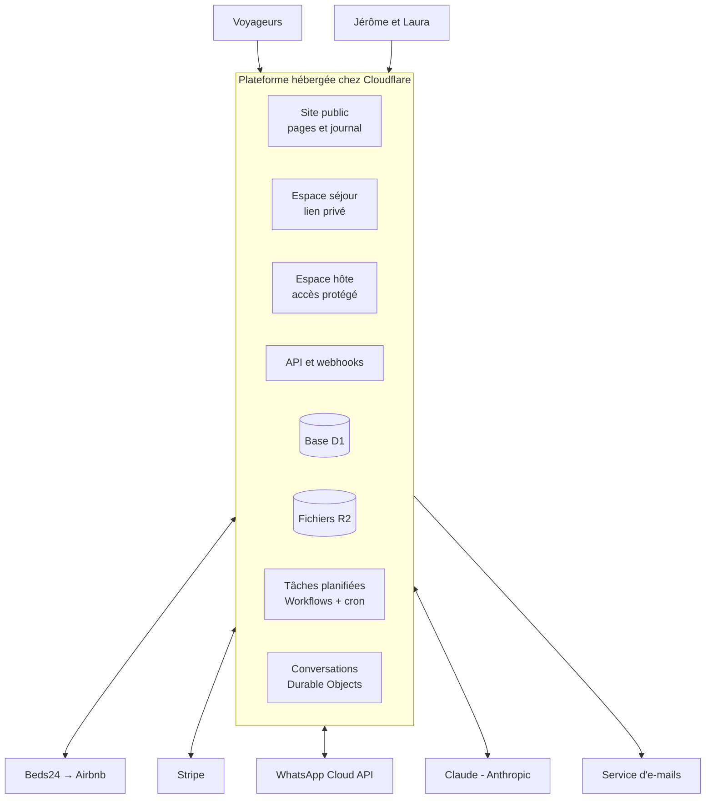
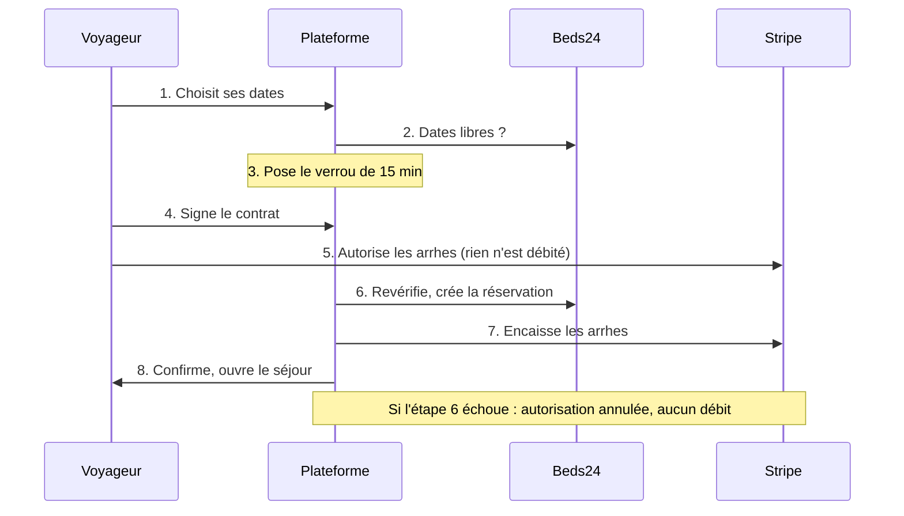

# Architecture – Plateforme Le Habert insolite

Phase 3 BMAD (Solutioning) · 6 novembre 2026 · Jérôme

## Synthèse

La plateforme est une seule application web hébergée chez Cloudflare. Elle garde sa propre base de données, parle au socle Beds24 par une couche d'adaptation, et confie paiement, messagerie WhatsApp et IA à des services spécialisés.

Principes :

- **Une seule base de code, en TypeScript**, développée story par story avec Claude.
- **Nos données chez nous** : réservations, voyageurs, messages et contenus copiés dans la base de la plateforme ; le socle reste remplaçable.
- **Le socle fait foi pour les disponibilités**, la plateforme pour tout le reste.
- **Pages publiques rendues côté serveur**, rapides et lisibles par Google et les assistants IA.
- **Pas d'abonnement sans nécessité.**

Points à vérifier avant la story 1.1 :

- **Commission Airbnb** : connecter l'annonce à un logiciel de gestion impose la commission « hôte seul » de 15,5 %, contre environ 3 % côté hôte en modèle partagé. Une source indique qu'Airbnb fait passer tous les hôtes européens à ce modèle depuis le 13 octobre 2026. Vérifier la commission sur les derniers versements ; si l'annonce est encore en modèle partagé, relever le prix Airbnb d'environ 15 % pour garder le même revenu.
- **Signature électronique** : l'API Yousign démarre autour de 100 € par mois, trop cher pour une trentaine de contrats par an → signature simple intégrée (ADR-07).

## Vue d'ensemble

Les quatre applications (site public, espace séjour, espace hôte, API) sont un seul programme déployé d'un bloc, partageant base et stockage. La carte charge directement le Plan IGN de la Géoplateforme depuis le navigateur.

## Pile technique

| Besoin | Choix | Pourquoi | Alternative écartée |
| --- | --- | --- | --- |
| Langage | TypeScript partout | Un seul langage pour site, API et tâches | PHP du site v0 |
| Cadre du site | Astro + `@astrojs/cloudflare` | Rendu serveur, pages légères, routage i18n, îlots interactifs | SPA, moins bonne pour le référencement |
| Interface interactive | Îlots React (calendrier, tunnel, boîte de réception, espace hôte) | Écosystème riche | Svelte |
| Hébergement | Cloudflare Workers, offre payante (5 $/mois) | Base, fichiers, tâches, temps réel et protection au même endroit | Mutualisé PHP, VPS |
| Base de données | Cloudflare D1 (SQLite) + Drizzle ORM | 10 Go par base, restauration à la minute sur 30 jours | PostgreSQL externe |
| Fichiers | Cloudflare R2 | Photos, contrats signés, justificatifs, sauvegardes | — |
| Tâches planifiées | Cloudflare Workflows + Cron Triggers | Un parcours par séjour qui attend J-2, J0… sans perdre son état | Cron seul |
| Temps réel | Durable Objects | Chat et boîte de réception en direct | Rafraîchissement périodique (repli) |
| Accès hôte | Cloudflare Access | Double facteur sans écrire d'authentification | Système maison |
| Carte | Leaflet + Plan IGN (Géoplateforme, gratuit, sans clé) ; repli OpenStreetMap | Précis en montagne | Fonds payants |
| Mesure d'audience | Cloudflare Web Analytics + Search Console | Sans cookie | Google Analytics |

## Modèle de données

| Entité | Rôle | Données clés | Fait foi |
| --- | --- | --- | --- |
| Séjour | Réservation directe ou Airbnb | Dates, voyageurs, canal, statut, id socle, montant | Socle pour les dates ; plateforme pour le reste |
| Voyageur | Personne qui réserve | Nom, e-mail, téléphone, langue, consentement lettre | Plateforme |
| Verrou de créneau | Dates gardées pendant le tunnel | Nuits, expiration 15 min | Plateforme |
| Devis | Calcul figé à la réservation | Lignes, arrhes, solde, version des règles | Plateforme |
| Règle de prix | Saisons, week-ends, vacances, dernière minute | Période, type, valeur, priorité | Plateforme → socle |
| Contrat | Document signé | Version du modèle, PDF dans R2, empreinte SHA-256, preuves | Plateforme |
| Paiement | Arrhes, solde, caution, remboursement | Type, montant, statut, id Stripe, échéance | Stripe (recopié) |
| Fil et message | Conversation par séjour | Canal, auteur, texte, mode, transfert | Canal d'origine (recopié) |
| Connaissance | Ce que l'assistant sait | Rubrique, texte par langue, statut « à relire » | Plateforme |
| Lieu | Bon plan | Position, catégorie, saison, fiche par langue | Plateforme |
| Article | Billet du journal | Notes et photos d'origine, texte par langue, statut, date, auteur | Plateforme |
| Texte traduit | Tout texte visible du voyageur | Clé, langue, texte, relu | Plateforme |
| Recette / dépense | Lignes comptables | Date, montant, catégorie, séjour, justificatif R2 | Plateforme |
| Nuitée taxée | Base de la taxe de séjour | Séjour, nuits, personnes assujetties, tarif | Plateforme |
| Journal d'audit | Qui a fait quoi | Action, auteur, date, avant/après | Plateforme |

Montants en centimes ; dates de séjour en jours locaux (Europe/Paris), sans heure.

## Intégrations

Chaque service est derrière une interface à nous (`src/adapters/`). Changer de prestataire = réécrire un adaptateur.

| Service | Usage | Sens | Points d'attention |
| --- | --- | --- | --- |
| Beds24 | Réservations, blocages, prix, messages Airbnb | Sortant + webhooks | Webhooks V2 à activer par le support ; délai moyen ~1 min ; jeton renouvelé automatiquement |
| Stripe | Arrhes + carte enregistrée, solde hors session, pré-autorisation caution, remboursements | Sortant + webhooks | Authentification forte possible au solde → lien de paiement en repli |
| Signature | Code à usage unique, preuves archivées (ADR-07) | Interne | Modèle relu par un juriste avant la V2 |
| WhatsApp (Meta) | Messages, modèles approuvés pour les rappels | Sortant + webhooks | Depuis le 1er octobre 2026 : 1 000 réponses de service gratuites par mois et par numéro, puis payantes ; modèles utilitaires payants |
| Claude (Anthropic) | Assistant, détection des sujets sensibles, brouillons et traductions | Sortant | Connaissance placée dans la demande, pas de base vectorielle ; réponses journalisées |
| E-mails | Confirmations, rappels, livret, factures | Sortant | SPF, DKIM, DMARC |
| Géoplateforme IGN | Fond de carte | Navigateur | Mention « © IGN » |
| Search Console | Suivi du référencement | Lecture | Domaine validé dès la V1 |

Webhooks entrants : signature vérifiée, charge enregistrée telle quelle, traitement en file, idempotence (une notification reçue deux fois ne crée jamais deux réservations).

## Flux critiques

**Réservation sans double vente** — on encaisse seulement une fois la réservation créée dans le socle.

Le verrou est une ligne en base avec contrainte d'unicité sur les nuits.

**Paiements planifiés** — un Workflow par séjour direct :

1. J-3 : envoi du livret d'accueil.
2. J-2 : pré-autorisation de la caution (autorisation prolongée demandée si la carte le permet).
3. J0 matin : prélèvement du solde ; en cas d'échec, lien de paiement et alerte hôte.
4. Solde réglé : envoi du code de la boîte à clés (si la règle est confirmée).
5. J+2 après le départ : libération de la caution sauf retenue déclarée.
6. Facture et écriture comptable générées.

Une annulation arrête le Workflow et applique les règles des arrhes.

**Synchronisation avec le socle** — webhooks Beds24 en temps réel + rapprochement toutes les 15 minutes sur 18 mois. Socle injoignable depuis 15 minutes → réservation directe suspendue et hôte alerté.

## Référencement et multilingue

- Adresses `/fr/`, `/en/`, `/de/`, `/nl/` avec chemins traduits ; la racine redirige selon la langue du navigateur, jamais pour les robots.
- hreflang sur chaque page, `x-default` vers l'anglais ; plan du site par langue régénéré à chaque publication.
- Pages vitrine et articles rendus côté serveur et mis en cache à la périphérie ; cache purgé à chaque modification. Prix et disponibilités chargés par un îlot.
- Données structurées (hébergement, article, fil d'Ariane, auteur) générées depuis la base.
- Images stockées dans R2, redimensionnées à la volée ; texte alternatif obligatoire dans les 4 langues.
- Objectif < 2 s en 4G mesuré à chaque mise en ligne.
- Textes non relus marqués « traduction automatique » dans l'espace hôte.

## Sécurité, données personnelles et sauvegardes

**Sécurité** : Cloudflare Access devant l'espace hôte ; espace séjour par lien signé expirant 30 jours après le départ ; secrets stockés chez Cloudflare, jamais dans le code ; aucune donnée de carte ne transite par la plateforme ; limitation de débit sur tunnel, chat et webhooks ; l'assistant ne peut déclencher aucun paiement, remboursement ni blocage.

**RGPD** : localisation européenne de la base demandée à la création (à confirmer) ; conservation : séjours et pièces comptables selon la loi (à confirmer avec l'expert-comptable), conversations 2 ans après le séjour, prospects 3 ans au plus ; export et suppression d'un voyageur ; sous-traitants listés dans la politique de confidentialité.

**Sauvegardes** : Time Travel D1 (30 jours) ; export complet chaque nuit vers R2, conservé 12 mois ; copie mensuelle téléchargeable ; test de restauration trimestriel.

## Coûts estimés

| Poste | Coût | Base |
| --- | --- | --- |
| Cloudflare | 5 $/mois | Offre Workers payante |
| Beds24 | ~17 €/mois | À confirmer pendant le test |
| Claude | 5 à 15 €/mois (estimation) | À mesurer en V1.5 et V4 |
| WhatsApp | ~0 € | 1 000 réponses gratuites/mois |
| E-mails | 0 € | Offre gratuite d'un service d'envoi |
| Signature | 0 € | Intégrée (ADR-07) |
| Nom de domaine | ~1 €/mois | |
| Stripe | 1,5 % + 0,25 € par paiement | Cartes européennes standard |

Exemple : séjour de 600 € → ~9,50 € de frais Stripe en direct, contre 93 € de commission Airbnb à 15,5 %.

## Décisions d'architecture (ADR)

| ADR | Décision | Raison | Conséquence |
| --- | --- | --- | --- |
| ADR-01 | Tout héberger chez Cloudflare | Tout au même endroit pour 5 $/mois | Dépendance limitée par l'export nocturne |
| ADR-02 | Astro rendu serveur + îlots React | Référencement, rapidité mobile | Conventions à cadrer |
| ADR-03 | Le socle fait foi pour les disponibilités, la plateforme copie tout | Fiabilité et indépendance | Rapprochement toutes les 15 min |
| ADR-04 | Un adaptateur par service externe | Changer de prestataire sans réécrire l'application | Un peu plus de code au départ |
| ADR-05 | Arrhes autorisées puis encaissées après création dans le socle | Aucun débit sans réservation réelle | Paiement en deux temps |
| ADR-06 | Un Workflow par séjour | Échéances fiables et reprenables | Arrêt propre en cas d'annulation |
| ADR-07 | Signature électronique simple intégrée (code à usage unique, empreinte du PDF, horodatage, journal de preuves) | Yousign API > 100 €/mois pour ~30 contrats/an | Validation juridique requise ; Yousign branchable par l'adaptateur |
| ADR-08 | Boîte de réception construite en propre | Chatwoot = serveur à maintenir ou intermédiaire de plus | Interface à développer en V4 |
| ADR-09 | Pas de base vectorielle pour l'assistant | La connaissance d'un chalet tient dans une demande | À revoir si elle grossit |
| ADR-10 | Google Location de vacances reporté après la V2 | Le lien mène à la page Beds24, hors de notre tunnel | À réévaluer |
| ADR-11 | Carte Leaflet sur Plan IGN | Gratuit et précis en montagne | Repli OpenStreetMap |
| ADR-12 | Accès hôte par Cloudflare Access | Double facteur sans développement | Configuration pour Jérôme et Laura |

## Risques techniques

| Risque | Parade |
| --- | --- |
| Commission Airbnb portée à 15,5 % en connectant le socle | Vérifier avant la story 1.1 ; ajuster le prix Airbnb |
| API Beds24 incomplète (messages, webhooks) | Story 1.1 avant tout développement ; Smoobu en alternative |
| Authentification forte au prélèvement du solde | Lien de paiement automatique et alerte |
| Signature simple contestée | Validation juridique ; Yousign activable |
| Réponse fausse de l'assistant | Connaissance limitée aux textes de l'hôte, sujets sensibles transmis, journal |
